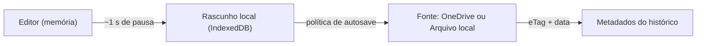
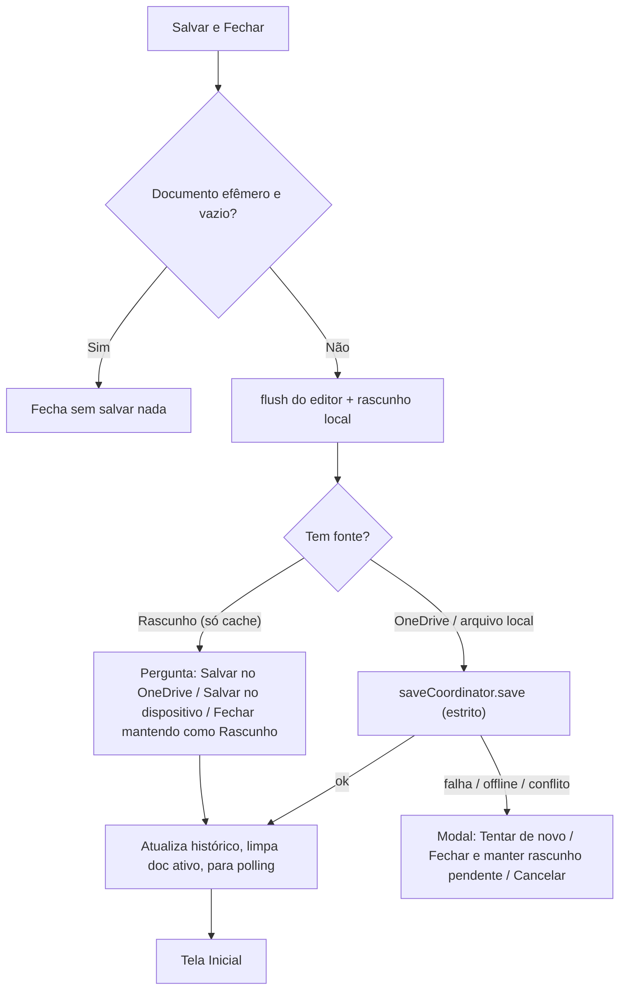

# Plano: Sistema de Salvamento Robusto + "Salvar e Fechar"

> [!NOTE]
> **Revisão 3** — todas as decisões fechadas. Nenhum código foi alterado ainda.

### Decisões tomadas
| Tema | Decisão |
|---|---|
| Após fechar | **Tela Inicial** (Abrir / OneDrive / Novo / Recentes) |
| Autosave OneDrive | **Automático com a nova política** (2.4) |
| Autosave arquivo local (PC) | **Automático também**, direto no arquivo (2.4.1) |
| "Sem Título.md" com texto | **Aparece no histórico como Rascunho** (2.7) |
| Documento sem fonte | **Salvar oferece "Salvar no OneDrive"** (criar arquivo numa pasta) além de baixar no dispositivo (3.4) |
| Nome repetido no OneDrive | **Renomeia automaticamente com "(1)", "(2)"…** (3.4) |
| Rascunhos e limite do histórico | **Contam nos 30**, sem cota separada (2.6) |
| Ritmo | **Uma fase por vez**, cada uma entregue e validada antes da próxima |

---

## 1. Diagnóstico do sistema atual

Li o fluxo completo (`useAppStore`, `storage`, `recentDocumentsService`, `useAutoSaveAndSync`, `Header`, `OneDriveModal`, `TiptapEditor`). Além do que você já percebeu, há problemas concretos:

### 1.1 Por que o autosave parece "lento e pouco confiável"
| # | Problema | Onde |
|---|---|---|
| A | Latência real de **~14,5 s** até a nuvem: o editor só serializa o Markdown após **7 s** de pausa (o README diz 600 ms) e só então começa o debounce de **7,5 s** do OneDrive. | [TiptapEditor.tsx:L264-L267](file:///c:/Users/carva/Documents/Antigravity/web-leitor-editor-md/src/components/editor/TiptapEditor.tsx#L264-L267), [useAutoSaveAndSync.ts:L7](file:///c:/Users/carva/Documents/Antigravity/web-leitor-editor-md/src/hooks/useAutoSaveAndSync.ts#L7) |
| B | Digitação contínua **nunca** salva na nuvem (o debounce reinicia sempre; não há "tempo máximo de espera"). | idem |
| C | Após o PUT, grava no cache usando `currentDoc` **capturado antes do flush** → conteúdo velho competindo com o novo no IndexedDB. | [useAutoSaveAndSync.ts:L78-L83](file:///c:/Users/carva/Documents/Antigravity/web-leitor-editor-md/src/hooks/useAutoSaveAndSync.ts#L78-L83) |
| D | Salvar pelo modal do OneDrive **não atualiza `cloudLastModified`** → o polling acha que a nuvem mudou e baixa de volta o próprio arquivo, ou dispara **falso conflito** se você voltou a digitar. | [OneDriveModal.tsx:L185-L187](file:///c:/Users/carva/Documents/Antigravity/web-leitor-editor-md/src/components/modals/OneDriveModal.tsx#L185-L187) |
| E | O PUT não usa `If-Match`/eTag: a detecção de conflito é só por comparação de horário (com tolerância de 1 s), podendo sobrescrever edição feita em outro dispositivo. | [oneDriveService.ts:L78-L87](file:///c:/Users/carva/Documents/Antigravity/web-leitor-editor-md/src/services/oneDriveService.ts#L78-L87) |
| F | O botão **Salvar** do Header, num arquivo do OneDrive, **não salva no OneDrive**: abre o "Salvar como" local (ou baixa uma cópia no celular). | [Header.tsx:L310-L356](file:///c:/Users/carva/Documents/Antigravity/web-leitor-editor-md/src/components/layout/Header.tsx#L310-L356) |
| G | `Ctrl+S` aparece na dica do botão, mas **não existe atalho implementado**. | [Header.tsx:L539](file:///c:/Users/carva/Documents/Antigravity/web-leitor-editor-md/src/components/layout/Header.tsx#L539) |
| H | Fila offline (`addToOfflineQueue`) existe mas **nunca é usada**; voltar online não reenvia nada. | [storage.ts:L129](file:///c:/Users/carva/Documents/Antigravity/web-leitor-editor-md/src/services/storage.ts#L129) |

### 1.2 Riscos de perda de dados
- **"Salvar e continuar" segue em frente mesmo se o salvamento falhar ou for cancelado** (Header e OneDriveModal) → o arquivo novo é aberto por cima e as alterações se perdem. [Header.tsx:L205-L211](file:///c:/Users/carva/Documents/Antigravity/web-leitor-editor-md/src/components/layout/Header.tsx#L205-L211), [OneDriveModal.tsx:L154-L172](file:///c:/Users/carva/Documents/Antigravity/web-leitor-editor-md/src/components/modals/OneDriveModal.tsx#L154-L172)
- **Deduplicação do histórico por título**: abrir dois arquivos diferentes chamados `notas.md` (ou dois "Sem Título.md") faz um **apagar o outro** do cache. [recentDocumentsService.ts:L87](file:///c:/Users/carva/Documents/Antigravity/web-leitor-editor-md/src/services/recentDocumentsService.ts#L87)

### 1.3 O problema do documento em branco
- `createNewDocument()` grava imediatamente no `localStorage` e define `lastSavedAt` = agora (mentira: nada foi salvo). [useAppStore.ts:L180-L197](file:///c:/Users/carva/Documents/Antigravity/web-leitor-editor-md/src/store/useAppStore.ts#L180-L197)
- O filtro que evita o branco no histórico só cobre `content === ''`; um `"\n"` ou espaço já passa.
- Não existe o estado **"nenhum documento aberto"** — por isso hoje "fechar" só pode ser simulado criando um documento novo.

### 1.4 Desempenho do cache
- Cada flush do editor regrava **o array inteiro dos 30 documentos** (com conteúdo completo) no IndexedDB e reordena o histórico (`lastOpenedAt` muda ao *editar*, não só ao *abrir*).

---

## 2. Arquitetura proposta

### 2.1 Três camadas, com responsabilidades claras

| Camada | Papel | Quando grava |
|---|---|---|
| **Memória** | Estado vivo do ProseMirror | Instantâneo |
| **Rascunho local** | Rede de segurança contra perda (crash, aba fechada, offline) | ~1 s após pausar, e imediato em `visibilitychange`/`pagehide` |
| **Fonte** | O arquivo "de verdade" (OneDrive / arquivo local com permissão) | Política inteligente (2.4) ou `Ctrl+S` |

### 2.2 Modelo de revisões (substitui o `isDirty` booleano)
Cada documento ganha contadores monotônicos:
- `revision` — incrementa a cada edição.
- `draftRevision` — última revisão gravada no IndexedDB.
- `sourceRevision` — última revisão confirmada na fonte.

Daí derivamos tudo sem ambiguidade: *"tem alteração não salva na fonte?"* = `revision > sourceRevision`. Isso elimina corridas do tipo "salvei a versão N, mas a N+1 chegou durante o PUT e foi marcada como limpa".

### 2.3 Um único coordenador: `saveCoordinator`
Novo serviço (`src/services/saveCoordinator.ts`) que **todos** usam: botão Salvar, `Ctrl+S`, autosave, guarda de alterações, Salvar e Fechar, modal do OneDrive.
- Fila serializada: no máximo 1 PUT em voo; pedidos durante o voo são **coalescidos** em um único próximo envio.
- Sempre faz `flushPendingEditorContent()` antes de ler o conteúdo.
- Retorna um resultado tipado (`ok | conflict | offline | auth | error | cancelled`) — quem chama **decide com base no resultado** (corrige os riscos de 1.2).
- Remove a lógica de salvamento duplicada hoje espalhada em 3 arquivos.

### 2.4 Política de autosave para a fonte (responsiva + respeitando rate limit)
| Gatilho | Ação |
|---|---|
| **3 s** sem digitar | Salva |
| Digitação contínua por **30 s** (max-wait) | Salva mesmo assim |
| Janela perde foco / aba oculta / app vai para segundo plano | Salva imediatamente |
| `Ctrl+S` / botão Salvar | Salva imediatamente |
| Voltou a ficar online | Reenvia o pendente |
| Falha de rede | Retentativa com backoff (5 s → 15 s → 60 s) |

Pior caso: ~2 PUTs/min em digitação contínua — muito abaixo do limite do Graph.

A política vale para **qualquer fonte gravável**: OneDrive e arquivo local com permissão. Documentos só-cache (rascunhos) têm apenas o rascunho local automático.

#### 2.4.1 Autosave em arquivo local (PC)
- Usa o `FileSystemFileHandle` já obtido em "Abrir" ou "Salvar como" (`createWritable()`), com a mesma política acima.
- **O handle é guardado no IndexedDB** junto do documento (handles são serializáveis), então reabrir pelo histórico volta a gravar no mesmo arquivo.
- O navegador pode exigir reconfirmar a permissão após recarregar (`queryPermission` → `requestPermission`, que precisa de um clique). Nesse caso o status mostra **"Clique para reconectar o arquivo"**; até lá as edições ficam seguras no rascunho local e são gravadas assim que a permissão volta.
- Detecção de alteração externa: antes de gravar, compara `file.lastModified` com o último valor conhecido; se o arquivo mudou fora do app ⇒ modal de conflito (mesmo do OneDrive).
- Navegadores sem File System Access (iPad/Safari, Firefox): não há autosave no arquivo — cai no fluxo de 3.4.

### 2.5 Conflitos de verdade com eTag
- PUT com `If-Match: <eTag>`. Resposta **412** ⇒ alguém alterou na nuvem ⇒ abre o `CloudConflictModal` existente.
- Polling continua, mas compara **eTag** (exato) em vez de horário ± 1 s.
- Após salvar, guarda o novo eTag/`lastModifiedDateTime` (corrige o item D).

### 2.6 Armazenamento local reestruturado
- **Uma chave por documento** no IndexedDB (`doc:<chave>`) + um **índice leve** (`recents_index`: título, origem, datas, flags).
- Editar só regrava a chave daquele documento; o índice só muda ao abrir/salvar/fechar.
- `lastOpenedAt` só muda ao **abrir**.
- Chave estável: `onedrive:<itemId>`, `file:<uuid>` (arquivo local com handle) ou `draft:<uuid>` (rascunho) — **nunca** título (corrige a deduplicação).
- O índice registra o **tipo** de cada item (OneDrive / Arquivo local / Rascunho) para o histórico exibir o selo certo.
- Migração automática do formato `leitor_md_recent_documents_v1`, descartando entradas em branco com nome padrão.

### 2.7 Regra do documento em branco: "documento efêmero"
- **Novo documento** nasce `ephemeral: true` e **não é persistido em lugar nenhum** (nem localStorage, nem IndexedDB, nem histórico).
- Ele só vira persistente quando tiver **conteúdo significativo** (`content.trim() !== ''`) **ou** for renomeado **ou** salvo explicitamente.
- Ao virar persistente, entra no histórico com o selo **Rascunho** (chave `draft:<uuid>`), mesmo com o nome "Sem Título.md".
- Vários rascunhos "Sem Título" coexistem sem se sobrescrever (chave por uuid; exibidos como "Sem Título", "Sem Título (2)"…).
- Quando um rascunho é salvo numa fonte (OneDrive ou arquivo), ele é **promovido**: a entrada `draft:` é substituída pela da fonte, sem duplicar no histórico.
- Se voltar a ficar vazio sem nunca ter sido salvo numa fonte → o rascunho é removido do histórico.
- `lastSavedAt` passa a ser `null` até existir salvamento real.
- Fechar um documento efêmero = descartar silenciosamente, sem perguntar.

---

## 3. "Salvar e Fechar" (e "Fechar")

### 3.1 Novo estado: nenhum documento aberto
`document: DocumentState | null`. Com `null`:
- Editor não é montado; mostra a **Tela Inicial** (decidido). O conteúdo do `WelcomeScreen` vira um componente `HomeScreen` reutilizável, exibido de duas formas: como overlay na abertura do app (como hoje) e como tela principal quando não há documento aberto. O Header fica reduzido (logo, Aparência, OneDrive).
- Polling e autosave ficam parados; o ponteiro de "documento ativo" no localStorage é limpo.
- "Continuar Último" na abertura do app passa a abrir o primeiro do histórico (ou fica oculto se não houver).

### 3.2 Fluxo "Salvar e Fechar"

Garantias:
- **Nunca fecha com perda**: mesmo "fechar mesmo assim" mantém o rascunho no IndexedDB marcado como *pendente de envio*, reenviado ao reabrir/voltar online.
- Não cria documento em branco.

Observação: "Fechar mantendo como Rascunho" é uma saída válida e sem perda — o rascunho continua no histórico com o selo **Rascunho**.

### 3.3 Onde fica na interface
- Botão **Fechar** (ícone `X`) ao lado do título, com menu: *Salvar e Fechar* (padrão) / *Fechar sem salvar*.
- Mesmo item no menu mobile.
- Indicador de status único substituindo o ponto âmbar e o texto "Salvo em cache":
  `Editando…` · `Rascunho salvo neste navegador` · `Salvando…` · `Salvo no OneDrive às 09:12` · `Salvo no arquivo às 09:12` · `Pendente (offline)` · `Reconectar arquivo` · `Conflito` · `Erro — tentar novamente`.

### 3.4 "Salvar" em documento sem fonte (rascunho ou arquivo aberto no iPad)
O botão Salvar / `Ctrl+S` abre um pequeno menu de destino:
1. **Salvar no OneDrive** — abre o `OneDriveModal` em **modo "Salvar como"**: navegar pelas pastas, editar o nome e confirmar. Cria o arquivo com `PUT /me/drive/items/{pastaId}:/{nome}:/content`. A partir daí o documento passa a ter fonte OneDrive e entra no autosave.
2. **Salvar no dispositivo** — no PC usa `showSaveFilePicker` (vira fonte "arquivo local" com autosave); no iPad/Safari faz o download/"Salvar em Arquivos" (sem autosave, pois o navegador não permite regravar).
- O último destino escolhido fica pré-selecionado na próxima vez.
- **Nome já existente na pasta** (decidido): renomeia automaticamente para `nome (1).md`, `nome (2).md`…
  - O app calcula o próximo nome livre consultando a pasta e envia com `@microsoft.graph.conflictBehavior=fail`; se outro dispositivo criar o mesmo nome no meio do caminho (409), tenta o próximo número.
  - Não uso o `conflictBehavior=rename` nativo do OneDrive porque ele gera `nome 1.md` (sem parênteses).
  - O título final é mostrado na confirmação ("Salvo como *nome (1).md*").

---

## 4. Fases de implementação (cada fase é entregável e testável sozinha)

| Fase | Conteúdo | Risco |
|---|---|---|
| **0. Correções urgentes** | Guarda só prossegue se salvar com sucesso; salvar manual atualiza eTag/`cloudLastModified`; corrige closure velha do autosave; deduplicação por chave e não por título; documento efêmero (não persistir branco); `Ctrl+S`; botão Salvar respeita OneDrive. | Baixo |
| **1. `saveCoordinator` + revisões** | Serviço central; Header, OneDriveModal e hook passam a usá-lo. Sem mudança visual. | Médio |
| **2. Armazenamento por documento** | Chaves por doc + índice leve + migração do v1. | Médio |
| **3. Nova política de autosave** | Idle 3 s + max-wait 30 s + blur/hide para OneDrive **e arquivo local**; `If-Match`/412; handle persistido + reconexão de permissão; retentativa e envio ao voltar online; serialização do editor reduzida (adaptativa ao tamanho do documento). | Médio |
| **4. Fechar / Salvar e Fechar** | `document: null`, `HomeScreen` reutilizável, fluxo da seção 3, guardas em todos os componentes que leem `document`. | **Maior** (toca vários componentes) |
| **4b. Salvar como no OneDrive** | Modo "Salvar como" no `OneDriveModal`, criação de arquivo via Graph, promoção de rascunho, menu de destino (3.4). | Médio |
| **5. Status, testes e README** | Indicador unificado; testes Vitest para coordenador (coalescência, falha, conflito), regra efêmera e migração; atualizar README. | Baixo |

> [!IMPORTANT]
> A Fase 0 já resolve os riscos de perda de dados e o branco no histórico, e pode ir antes de qualquer refatoração maior.

---

## 5. Regra de remoção do histórico (consequência da decisão "rascunhos contam nos 30")
Um rascunho **só existe no navegador**: se ele for empurrado para fora do histórico, o texto se perde para sempre (um arquivo do OneDrive ou local, não — ele continua na fonte). Por isso, mantendo a cota única de 30, a ordem de quem sai quando entra o 31º é:
1. O item **mais antigo que tenha fonte** e esteja sincronizado (sai só do cache; o arquivo continua no OneDrive/disco).
2. Itens com **alterações pendentes de envio nunca saem**.
3. Se os 30 forem todos rascunhos, o app **avisa** antes e pede para salvar ou excluir algum, em vez de apagar sozinho.

---

## 6. Fase 0 — checklist detalhado (próximo passo)
Escopo pequeno, sem refatoração estrutural; prepara o terreno para as fases seguintes.

| # | Correção | Arquivos |
|---|---|---|
| 0.1 | "Salvar e continuar" só prossegue se o salvamento **realmente** deu certo (cancelou/falhou ⇒ permanece no documento atual com aviso). | `Header.tsx`, `OneDriveModal.tsx` |
| 0.2 | Botão Salvar: documento do OneDrive salva **no OneDrive**; arquivo local com handle grava no arquivo; sem fonte mantém o comportamento atual (menu da 3.4 vem na Fase 4b). | `Header.tsx` |
| 0.3 | Atalho **`Ctrl+S` / `Cmd+S`** chamando o mesmo salvar (bloqueando o "Salvar página" do navegador). | `App.tsx` |
| 0.4 | Todo salvamento manual no OneDrive atualiza `cloudLastModified` com a resposta do servidor (fim dos falsos conflitos). | `Header.tsx`, `OneDriveModal.tsx` |
| 0.5 | Autosave grava no cache com o conteúdo **fresco** (não a cópia antiga capturada antes do flush). | `useAutoSaveAndSync.ts` |
| 0.6 | Histórico deduplica pela **chave** do documento, nunca pelo título. | `recentDocumentsService.ts` |
| 0.7 | **Documento novo não é persistido** enquanto vazio (usa `trim()`), `lastSavedAt` começa `null`; limpeza única das entradas em branco "Sem Título.md" já existentes no histórico e no localStorage. | `useAppStore.ts`, `storage.ts`, `recentDocumentsService.ts` |
| 0.8 | Testes Vitest para 0.6 e 0.7 + `npm.cmd run build` e verificação no navegador. | `*.test.ts` |

> [!NOTE]
> O selo "Rascunho", a regra de remoção da seção 5 e o fechar ficam para as fases 2 e 4, como planejado.
